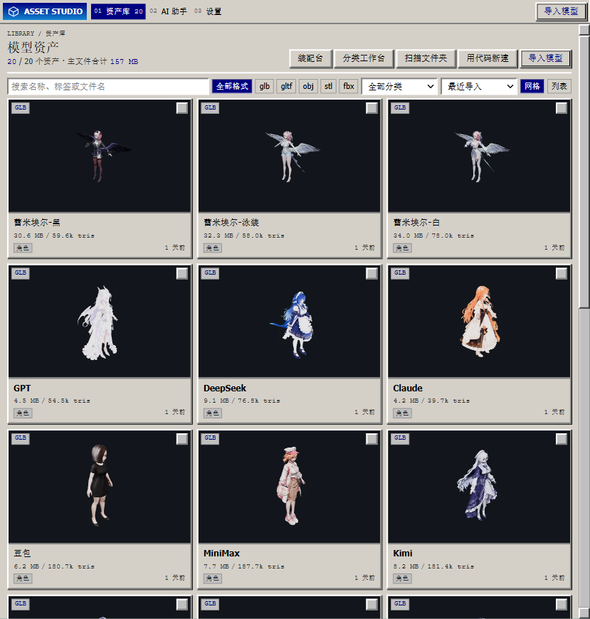
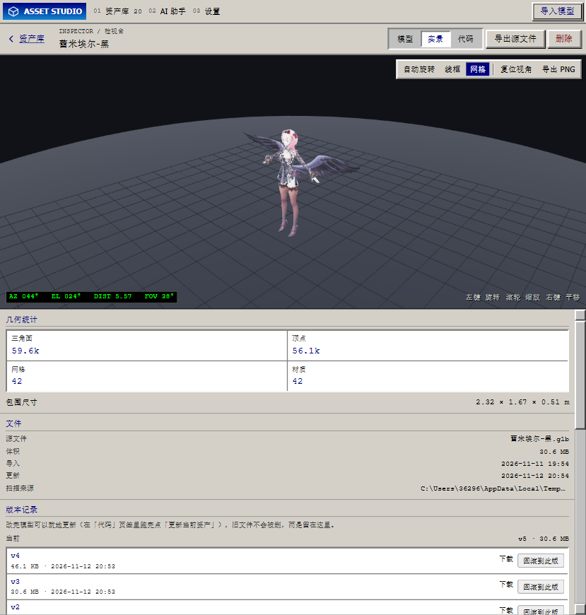
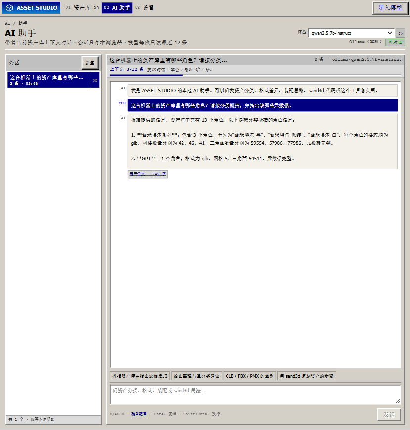
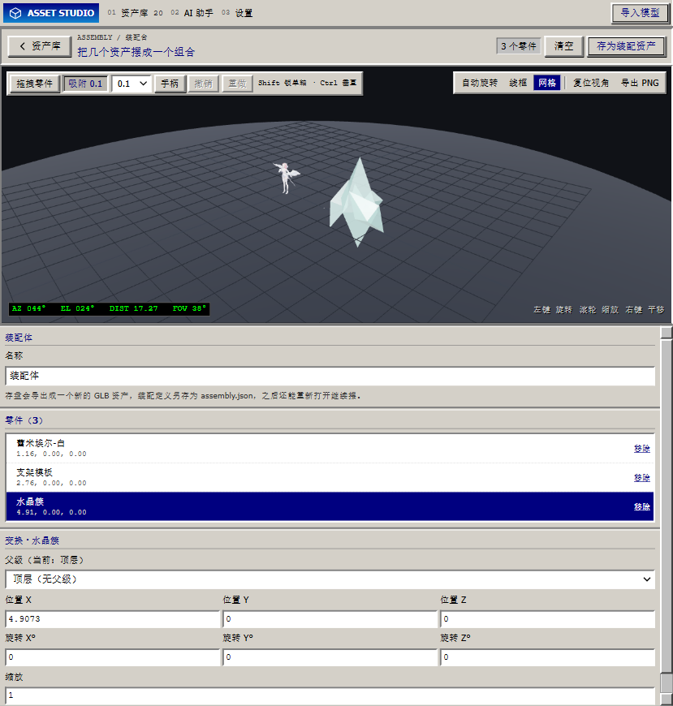
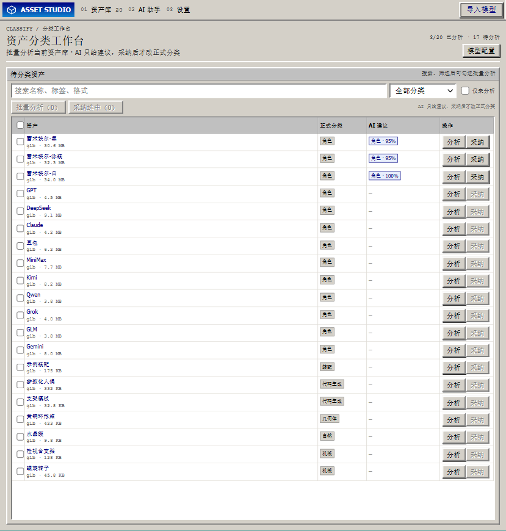
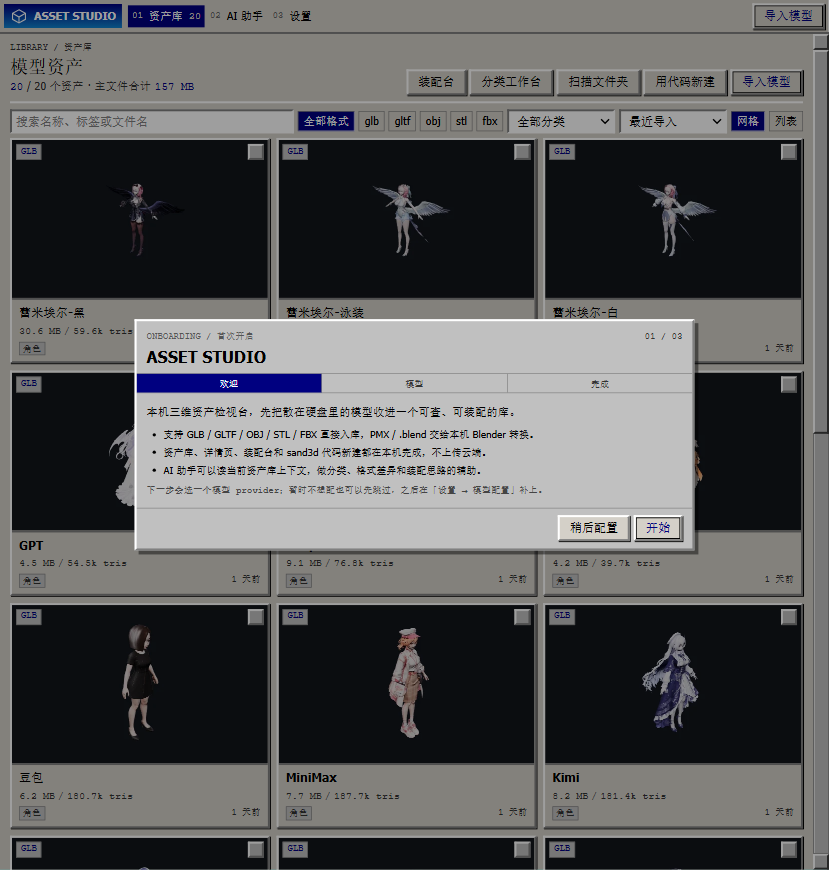
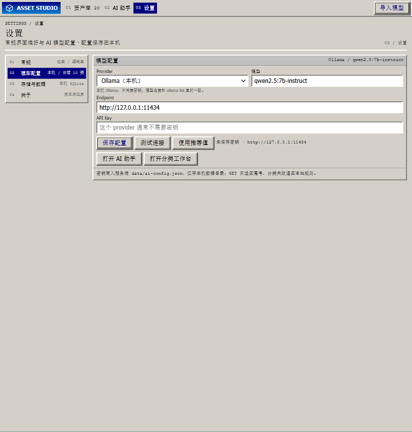
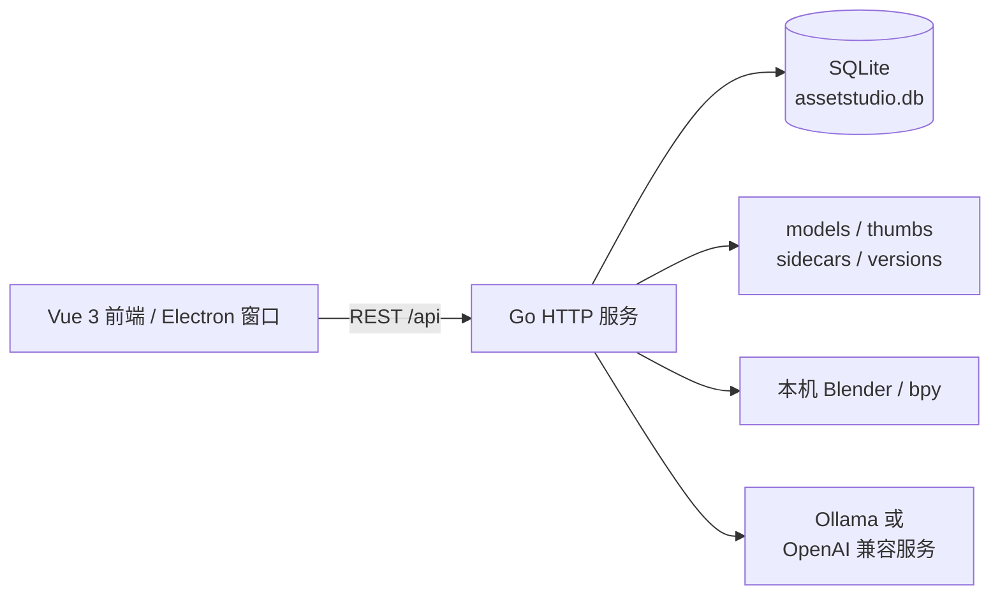

# ASSET STUDIO · 本机三维资产工作台

> 把散落在硬盘里的 GLB / GLTF / OBJ / STL / FBX / PMX / `.blend` 收进一个可检视、可装配、可对话的本地工作台。
>
> 模型、缩略图、元数据、版本和 AI 配置都留在你自己的电脑上；不是又一个在线模型预览页。


<p align="center">
  
</p>

<p align="center"><b>资产库 · 20 个真实资产 / 157.5 MB / 全部在本机 · Dev-C++ / Win9x 经典灰</b></p>

## 它是什么

**把硬盘里的 3D 资产，变成一个能看、能摆、能问的工作台。**

ASSET STUDIO 不是“上传一个模型、转一圈看看”的网页。它把导入、检视、代码建模、装配、版本管理和 AI 助手放进同一个本机应用，适合个人美术、独立游戏、MMD / Blender 素材库这类“文件很多、格式很杂、还经常要改”的场景。

- **收得进来**：GLB / GLTF / OBJ / STL / FBX 直接拖入；PMX / `.blend` 交给本机 Blender 无头转换。外链 `.bin`、贴图、`.mtl` 会作为 sidecar 一起收进库。
- **看得清楚**：模型 / 实景 / 代码三种模式共用同一个资产；几何统计、包围盒、缩略图、版本记录一页看完。
- **摆得起来**：装配台支持父子层级、数值变换、三轴手柄、拖拽吸附、撤销 / 重做，最后把组合烘焙成一个新的 GLB。
- **问得明白**：AI 助手读取当前资产库上下文；Ollama 本机直接聊，也支持 10 类 OpenAI 兼容 provider。分类只给建议，采纳后才改正式分类。
- **带得走**：同一套 Vue 前端 + Go 服务可以打包成 Electron 桌面安装包，Windows 双击启动，不依赖本机 Go。
- **有辨识度**：界面刻意做成 Dev-C++ / Win9x 经典灰——银灰面板、深蓝标题条、2px 立体凹凸边框、Tahoma / 宋体小字号；3D 视口保持黑底，不跟现代圆角渐变风。

## 实机展示

> 以下都是本机实际运行截图，不是渲染稿；数据来自当前的 20 个资产。

<p align="center">
  
  
</p>
<p align="center"><b>检视台</b>：三模式、几何统计、版本记录　·　<b>AI 助手</b>：本机 Ollama 真实回答，不是写死的文案</p>

<p align="center">
  
  
</p>
<p align="center"><b>装配台</b>：父子层级、拖拽 / 手柄、撤销重做　·　<b>分类工作台</b>：批量分析、逐条采纳，AI 只给建议</p>

<p align="center">
  
  
</p>
<p align="center"><b>首次启动</b>：三步引导，不配也能先跳过　·　<b>模型配置</b>：10 类 provider、推荐值、测试连接</p>

## 能力地图

| 你手里的问题 | ASSET STUDIO 的做法 |
| --- | --- |
| 模型散在几十个文件夹里，名字、格式、面数都记不清 | 拖入或扫描目录，按格式 / 分类 / 体积 / 面数筛选，缩略图自动补齐 |
| 想快速看结构，不想每次打开 Blender | 浏览器内 3D 视口，模型 / 实景 / 代码三模式，自动旋转、线框、网格、复位、导出 PNG |
| 想改一个零件，但不想重建整个模型 | 代码模式用 sand3d 真跑，支持源码 / 由模型反推；改完可就地更新并保留旧版本 |
| 多个资产要摆成一个场景 | 装配台把零件摆位、挂父子层级、拖拽 / 手柄调整，最后导出为一个 GLB |
| 资产太多，分类和描述写不过来 | AI 分类工作台批量给建议，逐条采纳；助手还能基于当前库存回答问题 |
| 不想开命令行，也不想装 Go | Electron 桌面版双击启动，内置 Go 服务和前端，数据放在用户目录 |

## 它怎么跑



浏览器开发版和 Electron 桌面版共用同一份前端与 Go 服务；桌面版只是把服务编译成 `asset-studio-server.exe`，启动时拉起、关窗时结束。模型文件和数据库默认只写本机，只有你主动配置云端 AI provider 时，助手才会把裁剪后的资产摘要发给对应服务。

## 从 GitHub 获取

仓库：[`highho/ASSET-STUDIO`](https://github.com/highho/ASSET-STUDIO)

```powershell
git clone https://github.com/highho/ASSET-STUDIO.git
cd ASSET-STUDIO
npm install
```

仓库只提交源码、示例和前端资源；`server/data`（资产、SQLite、缩略图）、`dist`、`release`、`desktop/bin`、`node_modules`、`tools/mmd` 都在 `.gitignore` 里。第一次运行前先按下面「快速开始」装依赖并在本机生成数据目录。

## 快速开始（浏览器开发版）

环境要求：Node 20+、**Go 1.23+**（`go.mod` 写明的下限；Go 1.21 会直接报版本不足，因为代码用了 `r.PathValue` 与新版 `ServeMux` 路由）。

首次装前端依赖：

```powershell
npm install
```

> 若卡在 `registry.npmmirror.com`（大包只下到几十 KB 就停），换镜像：
> `npm install --registry=https://mirrors.cloud.tencent.com/npm/ --replace-registry-host=always`

双击 `server\start-server.bat`（会打开一个命令行窗口并保持运行），然后在浏览器打开：

```
http://localhost:8080
```

默认只绑定 `127.0.0.1`，只有本机能访问。要临时让局域网看到（例如手机预览），必须显式写网卡 IP：

```powershell
go run . -addr 192.168.1.5:8080 -data ./data
```

此时启动日志会打一条警告；并且除「本机 Host」与「这个 IP 的 Host」以外的请求一律 403（见「边界」里的访问控制）。

脚本只用 PATH 里的 `go`，没有就报错退出。若 PATH 里的 Go 版本不够、或机器上有多个 Go，用环境变量指定 Go 根目录（含 `bin\go.exe`）：

```powershell
$env:ASSET_STUDIO_GO = "C:\Users\36296\tools\go1.24.13\go"
.\server\start-server.bat
```

手动启动等价于：

```powershell
$env:GOROOT = "C:\Users\36296\tools\go1.24.13\go"   # 本机全局 GOROOT 指向 ServBay 的 1.21，必须覆盖
$env:GOPROXY = "https://goproxy.cn,direct"
$env:GOTOOLCHAIN = "local"
$env:CGO_ENABLED = "0"
cd server
go run . -addr 127.0.0.1:8080 -data ./data
```

AI 运行时首次启动是**未配置**状态：没有 `server/data/ai-config.json` 时，后端不会自动写入 Ollama 或 `qwen2.5:7b-instruct`，`/ai` 会提示先配置。第一次打开前端会进入三步引导（欢迎 → 模型 → 完成），也可以在 `设置 → 模型配置`（`/settings?tab=model`）里改 provider / endpoint / model / API key；配置保存到 `server/data/ai-config.json`。环境变量只作为首次启动的种子值，文件里一旦有配置就以文件为准：

```powershell
$env:ASSET_STUDIO_AI_PROVIDER = "ollama"            # 见下面 10 类 provider
$env:ASSET_STUDIO_AI_URL = "http://127.0.0.1:11434"
$env:ASSET_STUDIO_AI_MODEL = "qwen2.5:7b-instruct"
$env:ASSET_STUDIO_AI_KEY = "sk-..."                 # 可选；云端 provider 用
```

Provider 共 10 类：`ollama` / `openai` / `deepseek` / `moonshot`（Kimi）/ `zhipu`（智谱 GLM）/ `dashscope`（通义千问百炼）/ `siliconflow` / `groq` / `lmstudio` / `custom`。只有 `ollama` 走原生 `/api/chat` 与 `/api/tags`；其余（包括本机 LM Studio 与自定义兼容端点）统一走 OpenAI 兼容的 `/v1/chat/completions` 与 `/v1/models`。前端的 10 组推荐值在 `src/lib/aiPresets.ts`，只用于「使用推荐值」或切换 provider 时填充表单，不会在加载时自动写进配置。

Ollama 没启动、模型没装或返回不是合法 JSON 时，分类会退回本地规则并在响应 `ai.provider` 标 `local-rules`，不会退回 501；助手对话则会明确报错，不会用规则伪装成 AI 回答。API key 只保存在服务端文件，`GET /api/ai/config` 只返回 `hasKey` 与尾号 `keyHint`，不返回明文。

前端代码改动后需要重新构建（Go 直接托管 `dist/`）：

```powershell
npm run build
```

普通开发启动仍用 `go run`。桌面版把同一份 Go 服务编译成独立的 `asset-studio-server.exe`，不再依赖本机 Go，见下一节。

## 桌面套壳（Electron）

桌面版是 Electron 外壳 + 同一个 Go 服务 + 同一个 `dist` 前端：启动时先拉起本机服务，等 `/api/health` 就绪后再打开窗口；关窗口时一并结束服务，不残留后台进程。

```powershell
npm run desktop:build     # npm run build + 编译 desktop\bin\asset-studio-server.exe
npm run desktop:run       # 开发运行，复用已在跑的 8080，或自己拉服务
npm run desktop:dist      # 生成 Windows 安装包：release\ASSET-STUDIO-0.1.1-Setup.exe
```

- 打包后的数据目录是 `%APPDATA%\asset-studio\data`，日志是同目录的 `server.log`；端口优先 `17890`，被占用就自动换一个空闲端口。要复用现有资产库，把 `server\data` 整个拷到 `%APPDATA%\asset-studio\data`，或者用 `ASSET_STUDIO_DATA` 指向已有目录。
- 开发模式 `desktop:run` 默认优先复用 `http://127.0.0.1:8080` 上已经在跑的服务，避免两个进程同时开同一个 SQLite；想强制用 `desktop\bin` 里的独立服务，设 `ASSET_STUDIO_REUSE_DEV_SERVER=0`。
- 安装包没有代码签名，Windows SmartScreen 可能提示「未知发布者」；当前使用 Electron 默认图标。构建脚本需要 Go 1.23+，机器级 GOROOT 指向别的版本时仍按上文的 `ASSET_STUDIO_GO` 方式 pin。

## Sand3D 的运行时

检视台的第三个模式（**代码**）把编辑器里的 Python 程序交给本机的 Blender 内核真跑。运行时有两种，任选其一：

**A. Blender 自带的 bpy（不需要 pip）** —— 机器上装了 Blender（含 UPBGE 这类分支）就够了：

```powershell
$env:SAND3D_BLENDER = "D:\upbge-0.50-windows-x64\blender.exe"   # 不设也行，见下面的候选顺序
```

`sand3d` 若不是 pip 装的、而是一份源码，把它别名成 `sand3d` 目录挂进 `runtime/`（本仓库已有一层 junction）：

```
runtime/sand3d  ->  H:\sand3d-plugin\_probe\sand3d_src    # 目录里要有 __init__.py
```

服务会把这个目录通过 `SAND3D_SRC` 传给执行器，执行器在 `import sand3d` 之前 `sys.path.insert`。真跑的命令是 `blender --background --factory-startup --python runner.py -- <program> <workdir> <out.glb>`。

**B. pip 装 bpy + sand3d 的 Python 3.11 / 3.13**（`bpy` 没有 3.12 的轮子）：

```powershell
$env:SAND3D_PYTHON = "C:\path\to\python311\python.exe"
& $env:SAND3D_PYTHON -m pip install sand3d -i https://pypi.tuna.tsinghua.edu.cn/simple
```

`pip install sand3d` 会把 `bpy` 4.5 一起装好（约 300 MB）。真跑的命令是 `python runner.py <program> <workdir> <out.glb>`。

探测顺序：Blender（`SAND3D_BLENDER` → `%ProgramFiles%\Blender Foundation\Blender*\blender.exe` → `D:\upbge*\blender.exe` → PATH 里的 `blender`）→ Python（`SAND3D_PYTHON` → `%LOCALAPPDATA%\Programs\Python\Python311|313` → `%USERPROFILE%\tools\python311` → `E:\python\python.exe` → PATH 里的 `python3.11` / `python3.13` / `python`）。两种都找不到时第三模式会直说「本机没有能跑 sand3d 的运行时」并提示 `SAND3D_SRC` / `SAND3D_BLENDER`，不会假装成功。结论成功缓存 10 分钟、失败 1 分钟，换位置不用重启服务。

运行结果里的零件数、面数、顶点数由执行器写在**工作目录的 `meta.json`** 里，不从 stdout 取 —— stdout 是程序自己的输出通道，用户程序打印一行 `S3D_META ...` 不应该能改写我们报告的统计。这份文件缺失或不是合法 JSON 时按「没有统计」处理，不会把一次成功的运行判成失败。

报错定位取 traceback 里**最内层**的用户程序帧（异常链会让 `program.py` 出现两次，取第一个会指到外层包装位置），错误那一句只认 `XxxError: ...` 这种形状，所以程序自己打印的「Error: …」不会被当成失败原因；过长的输出按字符截断并尽量停在行边界，中文不会出现半个字。

## MMD（PMX / .blend）素材

PMX / .blend 已经做成**产品内导入**：资产库页头「扫描文件夹」勾上 `PMX` 或 `BLEND`，服务端会在后台调用本机 Blender 无头转成 GLB，再走普通 GLB 的入库、指标解析和缩略图补齐。浏览器不解析这两类文件，转换失败会逐文件写进扫描作业的失败列表。

依赖装在仓库的 `tools/mmd`，第一次换机器跑一次：

```powershell
powershell -ExecutionPolicy Bypass -File scripts\setup-mmd.ps1
```

它会下载 `mmd_tools-v4.5.14-bl4.2.zip` 与 `opencc_python_reimplemented-0.1.7` 的 wheel，解包成 `tools/mmd/mmd_tools` 与 `tools/mmd/opencc`。Blender 自动探测（`MMD_BLENDER` → `SAND3D_BLENDER` → 常见安装路径）；也可用 `MMD_TOOLS_DIR` / `MMD_OPENCC_DIR` 指向别处。服务启动后 `GET /api/mmd/status` 会返回 `available`（有 Blender，`.blend` 可用）与 `pmxReady`（PMX 依赖齐全）。

也可以脱离产品手工转一次（仓库里的 `scripts/mmd2glb.py` 与后端内嵌的转换脚本是同一套做法）：

```powershell
$env:MMD_TOOLS_DIR  = "D:\tools\mmd\mmd_tools"
$env:MMD_OPENCC_DIR = "D:\tools\mmd\opencc"

# PMX -> GLB
& "D:\upbge-0.50-windows-x64\blender.exe" --background --factory-startup `
  --python scripts\mmd2glb.py -- pmx "H:\mmd\蕾米埃尔-白\蕾米埃尔-白.pmx" "$env:TEMP\remiel-white.glb"

# .blend -> GLB（不需要 mmd_tools）
& "D:\upbge-0.50-windows-x64\blender.exe" --background --factory-startup `
  --python scripts\mmd2glb.py -- blend "H:\mmd\模型\02_Claude_V3\model.blend" "$env:TEMP\claude.glb"
```

`MMD_TOOLS_DIR` / `MMD_OPENCC_DIR` 既可以指向包目录本身（`...\mmd_tools`），也可以指向包含包的父目录；脚本会把两者都收敛成可放进 `sys.path` 的父目录。

转换脚本里三个关键点，都是实测踩出来的：

- **不用 `addon_utils.enable('mmd_tools')`**：Blender 5.0 上它会去 wheels 目录找依赖并报 `FileNotFoundError`；改成 `sys.path` + `import mmd_tools` + `mmd_tools.register()`。注册时会打一条 `already registered as a subclass 'LogicNodeTree'`，是无害噪音。
- **导出前必须 `mmd_tools.convert_materials(use_principled=True)`**：PMX 材质是 MMD 专有节点，glTF 导出器只认 Principled BSDF。不转的话 `images=0 / textures=0`，贴图全丢，模型只剩材质底色。
- **导出必须 `use_visible=True`**：mmd_tools 会给每个刚体/关节建一个隐藏代理网格（一个模型 700+ 个），glTF 导出器默认连隐藏对象一起导出，人物外面会套一层白模；只导可见对象后 GLB 里是 1 个网格 + 40 来个按材质切的 primitive。

边界：转换只保证**静态网格 + 贴图**。PMX 的骨骼会作为 armature 导出，但动画、morph、物理刚体、MMD 卡通描边都不进 GLB；`.blend` 里若材质不是 Principled 链路，贴图可能只以其他通道存在（当前三种 LLM 人物显示正常，未逐材质深挖）。

## 目录

```
asset-studio/
├─ src/                 前端源码（Vue 3 + TS）
│  ├─ lib/model.ts      多格式解析、几何统计、离屏缩略图
│  ├─ lib/api.ts        后端接口封装
│  ├─ lib/seed.ts       内置示例资产的生成管线
│  ├─ lib/sand3d.ts     Sand3D 模板程序、由模型推代码（换轴在 worldBoxToSand3d）
│  ├─ lib/assembly.ts   装配定义（引用 + 父子层级 + 位置/旋转/缩放）的读写与自动摆位
│  ├─ lib/thumb.ts      缩略图失败次数（localStorage，三次封顶）
│  ├─ lib/convert-loss.ts 格式转换的损失说明（纯文案，不引 three）
│  ├─ components/SandLab.vue  代码模式：编辑器 + 真跑预览（standalone 时就是 /studio）
│  ├─ views/StudioView.vue    独立入口 /studio：不依附资产的「用代码新建」
│  ├─ views/AssemblyView.vue  独立入口 /assembly：装配台，把多个资产摆成一个 GLB
│  └─ stores/library.ts 资产库状态、导入、扫描、补齐
├─ tests/               前端单测（node --test，`npm test`）
├─ examples/sand3d/     可直接真跑的 sand3d 示例（底板沉孔 / 工作灯 / 参数化人偶）
├─ scripts/mmd2glb.py   PMX / .blend -> GLB 的无头转换入口（手工转换时用）
├─ scripts/setup-mmd.ps1  下载 mmd_tools + opencc 到 tools/mmd
├─ scripts/build-desktop.ps1  编译桌面服务 + 前端，供 Electron 打包
├─ desktop/main.cjs    Electron 主进程：拉本机服务、等健康检查、开窗口、退出时收尾
├─ desktop/splash.html 启动画面（Win9x 灰）
├─ desktop/bin/        桌面版 Go 服务（build-desktop.ps1 产物，不入库）
├─ tools/mmd/           PMX 转换依赖（mmd_tools + opencc，由 setup-mmd.ps1 安装）
├─ runtime/sand3d       sand3d 源码的目录联接（源码形态安装时作为 SAND3D_SRC）
├─ dist/                构建产物，由 Go 托管（不入库）
├─ release/             electron-builder 安装包与 win-unpacked（不入库）
└─ server/              Go 后端
   ├─ main.go           启动、静态站托管、SPA 回落
   ├─ internal/api/     REST 接口、文件夹扫描
   ├─ internal/api/mmd.go            扫描时的 PMX / .blend 转换调度（探测、超时、取消）
   ├─ internal/api/mmd/convert.py    交给 Blender 的转换脚本（与 scripts/mmd2glb.py 同源）
   ├─ internal/api/sand3d.go          sand3d 执行器（探测、限流、错误诊断）
   ├─ internal/api/sand3d/runner.py   交给 bpy 的 Python 侧执行器
   ├─ internal/store/   SQLite 读写
   └─ data/             assetstudio.db、models/、thumbs/、sidecars/、versions/（不入库）
```

## 已实现

- 导入 GLB / GLTF / OBJ / STL / FBX：浏览器内解析，计算顶点/三角面/网格/材质/包围盒尺寸，离屏渲染 512×320 缩略图，字节与元数据一并上传入库
- 外部资源与压缩格式：GLTF 外链的 `.bin`、贴图，OBJ 的 `.mtl` 与其贴图会随模型一起入库（落在 `data/sidecars/<id>/`，保留原始相对路径），加载时通过 `/api/assets/{id}/sidecars/{path}` 回读，所以 glTF 不再要求自包含；GLTF 的 Draco 压缩、meshopt 网格压缩、KTX2 / Basis 纹理都能解码（解码器放在 `public/draco`、`public/basis`，随站点托管，不依赖外网）。导入时可把附属文件连同主文件一起多选，也可以直接扫描带贴图的模型目录。格式白名单只在 `src/types.ts` 里定义一次（`MODEL_FORMATS` / `SIDECAR_FORMATS` 派生出 `MODEL_ACCEPT` / `MODEL_WITH_SIDECAR_ACCEPT`），侧栏和资产库两个入口共用同一份，带 `.bin` 的外链 glTF 从哪进都能选到附属文件
- 资产库：网格/列表双视图、搜索、格式筛选、分类筛选、四种排序、多选批量删除、整窗拖放导入、导入进度
- **界面风格：Dev-C++ / Win9x 经典灰**：全站换成银灰面板、深蓝渐变标题条、2px 立体凹凸边框、白色凹陷输入框与列表、Tahoma / 宋体小字号，滚动条也改成 16px 方块滚动条；资产卡、列表视图、弹层和详情检查器都按同一套语汇收紧。3D 视口保持黑底，坐标 HUD 改成黑底绿字的等宽状态行；代码页签改成白底黑字的经典编辑器，带按「原始源码 / 模型反推 / 独立模板」变化的提示条和行/列状态。代码页签现在是 **CodeMirror 6** 内核：行号（点行号跳转）、Python 语法着色、当前行高亮、括号/引号自动补全、`s3d.` API 候选（↑↓ 选择，Enter/Tab 接受）、代码折叠（点折叠槽或 Ctrl+Shift+[/]）、多光标（Ctrl+D 加选下一个匹配、Alt/Ctrl 点击加光标，状态栏显示「N 处光标」）、Ctrl+F 查找 / Ctrl+H 替换（面板可勾 Regexp 用正则、区分大小写、整词）、Ctrl+/ 注释切换，运行失败会自动跳到报错行。只改样式与编辑体验，不改数据结构
- 详情页：3D 视口（自动旋转/线框/网格/复位视角/导出 PNG）、元数据编辑保存、重新渲染缩略图、导出源文件、删除。包围尺寸带单位标注：GLB / GLTF 标 `m`（规范写死米），OBJ / STL / FBX 标「原始单位」—— 这三种文件里不写单位，按原值显示比假设成毫米更诚实
- 检视台三模式是**同一个资产**的三种表示：**模型**（统一换成素模材质、去掉地面阴影，只看结构比例）、**实景**（原贴图材质 + 环境光 + 地面接收投影）、**代码**（这个资产自己的 sand3d 程序 + 真跑出来的模型）。三种模式共用同一个模型对象，来回切换不会丢贴图
- 代码模式的来源按优先级两条：资产入库时写过 `source.py`（代码生成的资产）就直接读它，看见的是「当初生成这个资产的那段程序」；没有源码的资产（外部导入的模型）自动按模型反推一段可改的 `s3d.box` 程序，标题写明「由模型近似反推」。代码模式不再承担「新建模型」的职责 —— 新建走独立入口 `/studio`
- 用代码新建：资产库页头的「用代码新建」进 `/studio`（独立页，不依附任何已有资产），左边写程序、右边真跑预览，存盘时自己填资产名。生成它的源码完整保存在附属文件 `source.py`（不再塞进描述里按 4000 字截断）。`/studio` 提供两个能真跑的起步模板：「板件模板」与「人偶模板」—— 后者是 16 个零件的参数化人形（身高 / 肩宽 / 四肢粗细 / 站姿 / 头身比），改数字即改人，人体网格本身不做逆向
- 代码 → 模型：编辑器里的程序通过 `POST /api/sand3d/run` 交给本机 bpy 真跑，导出的 GLB 回传后直接进视口。状态栏给出 sand3d 版本、运行时（Blender 自带 bpy / pip bpy）、零件数、面数、顶点数、单位、耗时和源码指纹。程序出错时定位到**最内层**的用户程序行号，并把 sand3d 的原话整句显示出来（例如 `plate has no edge named ['nope']; its edge names: ['bottom', 'plate.bottom', 'plate.top', 'top']`），需要时可以展开完整 traceback
- 模型 → 代码：点「由模型推代码」，按每个网格的世界包围盒生成一段能直接运行的 `s3d.box` + `s3d.at` + `s3d.material` 程序，改数字就是改零件；跑出来的模型可以「存为新资产」，也可以「更新当前资产」（就地替换，见下一条）。换轴在 `worldBoxToSand3d` 一处完成（three 的 X→宽、Z→进深、Y→高，`at` 的 z 取底面），数字按毫米输出，`npm test` 有 4 条用例覆盖
- **就地更新与版本历史**：改完程序点「更新当前资产」，这一次真跑出来的 GLB 会替换掉当前主文件，名称/分类/描述不变，版本号 +1。旧文件不会被删，而是挪进 `server/data/versions/<id>/v<n>.<ext>` 并由 `asset_versions` 表记账；详情页右侧「版本记录」列出所有旧版（体积、被替换时间），可以下载，也可以「回滚到此版」。回滚同样走一次替换：被回滚掉的那一版也进版本记录，所以回滚还能再回滚，版本号只增不减。替换只允许**同格式**（GLB 换 GLB），换格式属于导入新资产
- **装配台**：资产库页头的「装配台」进 `/assembly`（独立页，不借某个资产的页签）。左边从库里挑资产加入，右边用数值填位置（X/Y/Z，场景单位）/ 旋转（X/Y/Z，度）/ 统一缩放，中间实时看合成结果；新零件自动排在已有零件右侧、底面贴地。右侧「变换」面板里可以把当前零件挂到另一个零件下：子级的位置 / 旋转 / 缩放变成相对父级，父级移动会带着子级一起走；挂载时用 `attach` 保住世界位置，移除父级时子级自动提回顶层并保持原位。中间视口左上角可开「拖拽零件」：左键按住零件在 X/Z 平面移动，默认 0.1 网格吸附（档位可在 0.01 / 0.05 / 0.1 / 0.25 / 0.5 / 1 之间切换），按住 Shift 锁定位移更大的那根水平轴；按住 Ctrl 再拖则改为垂直升降（X/Z 不动，Y 同样吸附）。每次拖拽记一条位置变更，可用「撤销 / 重做」按钮或 Ctrl+Z / Ctrl+Shift+Z / Ctrl+Y 回退；换父级、删零件、清空或重开装配定义会清掉这段历史。选中零件后还能点「手柄」，视口出现三轴手柄，并在「移动 / 旋转 / 缩放」之间切换：移动拖红 X / 绿 Y / 蓝 Z 轴，只改对应轴坐标，吸附步长与拖拽共用；旋转拖三色圆环，吸附可选 1° / 5° / 15° / 30°；缩放拖三色方块，按同一步长吸附。手柄的参考轴还能在「局部 / 世界」之间切换。拖拽、手柄改动和右侧数值输入共用同一份撤销 / 重做历史（记录位置、旋转、缩放的完整快照；数值输入一次聚焦到失焦算一条）。空白处左键仍然是旋转视角。存盘时把整个组合用 Three.js 的 GLTFExporter 导成一个新 GLB 资产（分类「装配」），同时把装配定义写成附属文件 `assembly.json`（引用了哪些资产、各自变换与父子下标）。之后从该资产详情页的「打开装配台 · N」能读回定义、重新摆；被引用的资产删了，重开时会跳过并提示缺了哪些零件。**没有新表、没有新资产类型**：装配体就是一个普通 GLB 加一个附属文件
- 格式转换：单资产或批量把 GLB / GLTF / OBJ / STL 转成 GLB / GLTF / OBJ / STL，全程在浏览器内用 Three.js 导出器完成，产物作为新资产入库、原件保留；自动继承分类与标签（追加「格式转换」）、在描述里记录转换来源、名字按「原名 (目标格式)」命名并避免后缀重复叠加。对话框里列出各格式的损失点；FBX 只能进不能出（Three.js 没有 FBX 导出器），界面上已注明
- **PMX / .blend 产品内导入**：资产库「扫描文件夹」的格式 chip 里直接有 `PMX` / `BLEND`。服务端在扫描作业中调用 Blender 无头转换，产物以 GLB 入库（分类沿用扫描分类，标签追加 `PMX` / `Blender`，描述记录源文件，`sourcePath` 记原始 PMX / .blend 以便判重）；指标当场由服务端解析，缩略图仍由前端补齐。PMX 转换会自动转 Principled 材质并只导出可见对象，避开贴图丢失与刚体代理白模两个坑；单个文件 10 分钟超时，取消扫描会杀掉 Blender 子进程。未配置依赖时 `GET /api/mmd/status` 会给出缺哪一项，扫描弹层也会在选中对应格式时提示
- **AI 助手 / 分类工作台 / 设置分三处**：侧栏固定 `01 资产库 / 02 AI 助手 / 03 设置`。`/ai` 只负责带资产库上下文的助手对话；资产库页头「装配台」后面的「分类工作台」进 `/classify`，承载批量分析、逐条建议与采纳；`/settings` 是设置页，子选项为「常规 / 模型配置 / 存储与数据 / 关于」，模型配置与常规界面偏好并列。详情页的「让 AI 分析」保留为单资产入口，旁边可直接跳到分类工作台。
- **MMD 素材入库结果**：`H:\mmd` 里的 3 个 PMX 人物（蕾米埃尔-白 / 黑 / 泳装）与 3 个只有 `.blend` 的人物（DeepSeek / Claude / GPT）全部入库，库内共 20 个资产、157 MB；三个 PMX 转换时补了 40–45 张内嵌贴图、剔掉 780 个隐藏刚体代理网格，并各留了一版替换历史（v3 为当前版）。产品内扫描链路已用 `H:\mmd\模型\02_Claude_V3`（`.blend`，1 网格 / 39,690 面）与 `H:\mmd\蕾米埃尔-白`（`.pmx`，1 网格 / 77,986 面 / 41 材质 / 35.7 MB）各跑通一次，测试资产随后删除
- 空库不再自动播种：库里没有资产时页面显示「载入 4 个示例资产」（黄铜环形结、水晶簇、检视台支架、螺旋转子），点一下才写入。早先是「库空就自动生成」，删空库后再刷新会「复活」，两个标签页同时首启还会各播一份
- **缩略图失败有上限、能手动重试**：补缩略图失败时按资产记次数（`localStorage` 的 `assetstudio.thumbAttempts`），三次封顶后不再自动重跑；卡片显示红色 `PREVIEW FAILED` 与「重试」按钮，点一下清计数只重跑这一条。失败资产在 `runInit` / 后端重连时直接标 `error`，不会每次进库都白解析一遍大模型
- **首屏拆包**：除资产库外的页面（详情、装配台、代码建模）全部按需加载；`stores/library` 对 three / 导出器 / placement / seed 改为 Promise 缓存的动态 `import()`，`export.ts` 的导出器按格式动态载入。资产库首屏 JS 从 985 kB 降到 142 kB，three 只在真正解析、渲染或转换模型时才下载

## 工程化

- **库结构版本化**：`PRAGMA user_version` 是唯一版本标记，程序认到 `schemaVersion = 4`。启动只跑「比当前版本新」的那几级（v1 建表 / v2 补指标、缩略图、墓碑列 / v3 唯一索引 + 缩略图回填 / v4 版本列与版本表），每级成功后立刻写回版本号，升到一半失败的库重启能接着升。读到比程序更高的版本直接拒绝启动 —— 回退代码要先降库，不能带着未知列继续跑。
- **日志带状态码与 request id**：每条 `/api/` 请求记 `方法 路径 状态码 耗时 字节数 rid=…`（例如 `GET /api/assets 200 0ms 2649B rid=9b576419b63f`），响应头同时给 `X-Request-Id`，用户报错截图能直接对上日志行。静态资源与 SPA 回落不记。
- **回落不吞 404**：带扩展名的路径（`/assets/x.js` 这种）找不到就返回 404，不再回 index.html —— 否则旧构建的浏览器会把 HTML 当 JS 解析，报一堆看不懂的语法错误。
- **优雅退出**：Ctrl+C / SIGTERM 后先取消在跑的作业并等它们在文件边界停下（最多 5 秒），再关服务器、等请求收尾（最多 15 秒）；停止信号通过 `BaseContext` 穿透到在跑请求，绑在里面的 bpy 子进程不会变成孤儿。
- **一条命令守门**：`powershell -ExecutionPolicy Bypass -File scripts\verify.ps1` 依次跑 `go vet ./...`、`go test ./...`、`npm run typecheck`、`npm test`、`vite build`，任何一步非零就失败退出。机器上有多份 Go 时用 `ASSET_STUDIO_GO` 指定要用的那一份。
- **加列有测试兜底**：`assets` 的列清单只有一处（`assetColumnList`），`Create` 的列名与占位符也从它生成；`store_test.go` 用 `PRAGMA table_info` 比对列清单、用写入—读回比对每个字段，加列时漏改会立刻红。
- **读可以并发**：每条连接自带 `busy_timeout=5000` 与 WAL，连接池 4；写仍由 SQLite 串行化。实测 2000 个文件扫描期间并发 1.2 万次读/写/增/删，0 个 5xx。写事务若排队超过 5 秒才会报错——单机场景够用，写密集时该改成队列化写。
- **后端断开自动重连**：页面每 5 秒探一次 `/api/health`。启动时没连上会等它恢复后自动拉列表；页面开着时后端挂了会标「未连接」，恢复后自动重连，不用手动刷新。

## 数据

| 位置 | 内容 |
| --- | --- |
| `server/data/assetstudio.db` | 资产元数据（SQLite，WAL 模式） |
| `server/data/models/<id>.<ext>` | 模型源文件 |
| `server/data/thumbs/<id>.webp` | 缩略图 |
| `server/data/sidecars/<id>/…` | 模型的外部资源（.bin / .mtl / 贴图，保留原始相对路径） |
| `server/data/versions/<id>/v<n>.<ext>` | 被替换下来的旧主文件（回滚用），由 `asset_versions` 表记账 |
| `server/data/trash/<id>/…` | 删除中转目录：文件先挪到这里，删库行成功后再清空；启动时也会清掉残留 |

换机器或备份，拷贝整个 `server/data` 目录即可。

## 指标从哪里来

几何数字不再只存在浏览器里：

- **导入与扫描时后端自己解析**：GLB / GLTF / OBJ / STL 由服务端直接读文件，算出三角面、顶点、网格、材质与包围盒，落库时 `metrics_state=ok`、`metrics_source=server`。扫描入库的资产当场就有面数，不需要打开网页补。
- **FBX 例外**：服务端不解析 FBX，入库时 `pending / client`，浏览器打开资产库时解析并回填，回填后变成 `ok / client`。
- **谁是权威**：`server` 的指标是权威，浏览器回填的 `PUT /api/assets/{id}/metrics` 会被忽略（返回库里真实值）。这样浏览器算错一次不会把库里的数字改坏，前端也不用改调用方式。
- **缩略图**：始终由浏览器离屏渲染后上传，`thumb_state` 记 `missing` / `ok` / `error`，`attempts` + `last_error` 记录失败次数与原因，便于以后停止无限重试。
- **补齐老数据**：`go run . -backfill -data ./data`，对缺指标或缺 `sha256` 的资产逐条解析后退出，不动缩略图。

## 删除与去重

- 删除是三步：**立墓碑**（立刻从列表消失）→ **文件挪进 `data/trash/`** → **删库行**。任何一步失败都停在那里，墓碑留到下次启动由对账收尾，不会出现「行删了文件还在」。
- 同一来源路径按**小写**唯一索引，Windows 下大小写不同不会被重复入库。

## 接口

| 方法 | 路径 | 说明 |
| --- | --- | --- |
| GET | `/api/health` | 存活与数据目录 |
| GET | `/api/assets` | 资产列表 |
| POST | `/api/assets` | 上传（multipart：file + meta + thumb + 可选 sidecar / sidecarPaths） |
| GET | `/api/assets/{id}` | 单个资产元数据 |
| PATCH | `/api/assets/{id}` | 更新名称/分类/标签/描述 |
| DELETE | `/api/assets/{id}` | 删除：墓碑 → 文件进 trash → 删行，失败留待启动对账 |
| GET | `/api/assets/{id}/file` | 取源文件字节 |
| POST | `/api/assets/{id}/replace` | 就地替换主文件（multipart：file + 可选 thumb / sidecar / sidecarPaths）：旧文件归档进 versions，版本号 +1；只允许同格式 |
| GET | `/api/assets/{id}/versions` | 版本记录：当前版本号 + 被替换下来的旧版本列表（倒序） |
| GET | `/api/assets/{id}/versions/{version}/file` | 下载某一版旧文件 |
| POST | `/api/assets/{id}/versions/{version}/restore` | 回滚到某一版（当前版同样归档，版本号继续 +1） |
| GET | `/api/assets/{id}/sidecars/{path}` | 取模型的外部资源（.bin / 贴图 / .mtl） |
| GET | `/api/assets/{id}/thumbnail` | 取缩略图 |
| PUT | `/api/assets/{id}/thumbnail` | 覆盖缩略图 |
| PUT | `/api/assets/{id}/metrics` | 回填几何统计（服务端已解析的资产会被忽略，返回库里的值） |
| POST | `/api/assets/{id}/classify` | AI 智能分类：按当前 `/api/ai/config` 的运行时读元数据给出建议，失败时规则兜底；只写 `ai_*` 三列 |
| GET | `/api/ai/config` | 读取 AI 运行时配置；只返回 `hasKey` / `keyHint`，不回传明文密钥；未配置时 `provider` / `endpoint` / `model` 为空 |
| PUT | `/api/ai/config` | 保存 provider / endpoint / model / API key；`apiKey` 省略或留空保留旧密钥，`clearKey` 清除；provider 必须在 10 类白名单内 |
| POST | `/api/ai/test` | 用保存的配置或表单覆盖值探测 Ollama `/api/tags` 或 OpenAI 兼容 `/v1/models`，返回 `ok / message / models`；未配置直接 `ok:false` |
| POST | `/api/ai/chat` | 助手对话；服务端把当前资产库摘要放进 system prompt，只接受 user / assistant 消息；未配置返回 400 |
| POST | `/api/scan` | 扫描文件夹批量入库：立刻返回 `202 {jobId}`，重名作业运行中则 `409` |
| GET | `/api/jobs` | 最近的作业列表（扫描等长任务），含状态、进度、结果 |
| GET | `/api/jobs/{id}` | 单个作业快照 |
| POST | `/api/jobs/{id}/cancel` | 取消作业（扫描在下一个文件的边界停下） |
| GET | `/api/stats` | 数量、主文件合计、分类分布 |
| GET | `/api/mmd/status` | PMX / .blend 转换运行时自检：`available`（有 Blender）、`pmxReady`（mmd_tools + opencc 齐全）与缺失原因 |

## AI 运行时、助手与分类（已接入）

- 页面分工：`/ai` 是助手对话；`/classify` 是资产分类工作台（从资产库页头「装配台」后面进入）；`/settings?tab=model` 是模型配置，和「常规 / 存储与数据 / 关于」并列为设置子选项。详情页「让 AI 分析」仍是单资产入口。
- **配置**：Provider 支持 10 类：`ollama` / `openai` / `deepseek` / `moonshot` / `zhipu` / `dashscope` / `siliconflow` / `groq` / `lmstudio` / `custom`。`ollama` 走原生 `/api/chat`、`/api/tags`；其余全部走 OpenAI 兼容的 `/v1/chat/completions`、`/v1/models`，包括本机 LM Studio 和自定义端点。`src/lib/aiPresets.ts` 给每组 provider 一个推荐 endpoint / model，只在切换 provider 或点「使用推荐值」时填表，不在加载时写配置。完整配置保存到 `server/data/ai-config.json`，每次请求按当前配置新建客户端，不需要重启。
- **未配置状态**：`ai.DefaultSettings()` 返回空配置，`Settings.Normalized()` 只清理、不自动补 Ollama / qwen；`Configured()` 要求 provider、endpoint、model 三者齐全。首次打开前端会进入 `OnboardingWizard` 三步引导（欢迎 / 模型 / 完成），完成后在 `localStorage` 写 `assetstudio.onboarded.v1=1`；跳过也会写，之后可以在「设置 → 模型配置」重新填。想再看到引导，清掉这个 key 后刷新。
- **常规设置**：默认资产视图（网格 / 列表）、进入资产库时是否自动补缩略图、清空缩略图失败计数；这些只影响当前浏览器，存在 `localStorage`。
- **密钥**：`GET /api/ai/config` 只返回 `hasKey` 与 `••••` + 尾 4 位；`PUT` 时 `apiKey` 省略/留空表示保留旧值，`clearKey: true` 才删除。密钥只存在服务端文件，前端不落 localStorage，也不出现在任何响应或日志里。
- **测试连接**：`POST /api/ai/test` 读模型列表而不是发一次真实对话，避免为了自检消耗 token；Ollama 读 `/api/tags`，OpenAI 兼容读 `/v1/models`，失败也返回 `200 + ok:false`，由页面显示原因。未配置时直接返回 `{ok:false, message:"AI 尚未配置…"}`。
- **助手会话**：`/ai` 左侧是会话列表，可新建、切换、删除；会话存在浏览器 `assetstudio.aiSessions.v1`，刷新后保留，最多 30 个会话、每个 300 条。切换会话时如果模型正在生成回答，会先禁用会话按钮，避免回答串到别的会话。
- **模型切换**：`/ai` 页头「模型」下拉读取本机已装模型（`POST /api/ai/test`），选中即写回服务端配置，只改 `model`，不会清掉 endpoint 和密钥；下一次回答使用新模型。旁边的 `↻` 可重新读取模型列表。Provider、端点、密钥等完整配置仍在 `/settings?tab=model`。
- **上下文长度**：每次请求只带最近 12 条消息；超过时顶部显示红色长对话提示，说明更早的消息仍在本页记录里但模型看不到。单条消息最多 4000 字，输入框实时计数，超长时发送按钮禁用；模型返回的长回答默认折叠，可展开全文。前端会按同样规则先截断超长消息，不再让后端静默丢弃。
- **助手对话**：后端读取当前资产库（数量、分类分布、总体量、最多 32 条资产样例）拼进 system prompt，再转发用户消息；客户端不能覆盖 system 消息。模型失败直接返回 `502`，不会用规则回答伪装成 AI。
- **分类工作台**：勾选资产批量调用 `POST /api/assets/{id}/classify`，逐条显示 `AI 建议 + confidence`；「采纳」才把建议分类与标签并入正式元数据。模型不可用时仍退回规则分类，`ai.provider` 标 `local-rules`，不会悄悄改正式分类。
- 默认模型首次调用要等加载（实测约 59 秒），之后热请求约 0.5 秒；当前实测 20 个资产、157.5 MB，助手热对话约 0.57 秒。
- 配置持久化只保存运行时参数，不保存每次分类的 `provider`；`ai_category / ai_confidence / ai_tags` 三列仍是唯一落库的分类结果。会话历史只存在当前浏览器，不写服务端；换浏览器或清 localStorage 会回到一个欢迎会话。

## 后续扩展

- 批量导入与文件夹扫描已经可用，下一步只差把扫描接到定时任务上（定时重扫目录、只增量入库）。

## 边界

- 数据只在本机，没有账号体系与多人共享；拷贝 `server/data` 迁移。
- 本机安全策略曾拦截过名为 `assetstudio.exe` 的构建产物，普通开发启动仍建议走 `go run`；桌面版由 `scripts/build-desktop.ps1` 单独编译 `desktop\bin\asset-studio-server.exe`，已实测可运行。
- 反推是近似重建，不是逆运算：网格是结果，sand3d 程序是构造过程，两者之间没有唯一解。按包围盒生成的程序只还原占地与高度，球、圆柱、倒角都会退化成方料；网格多于 40 个时只保留体积最大的 40 个。**单个网格、几千面以上的曲面资产（如环形结）反推后只剩一个盒子**，代码页签会在生成代码和提示里明确警告这种情况，别拿它当重建依据 —— sand3d 没有「导入网格」的动词，精确重建只能重写程序。
- 单位只标注、不换算：GLB / GLTF 按规范是米，OBJ / STL / FBX 文件里不写单位，界面标「原始单位」而不猜 —— 猜错会把整批资产显示成假数字。要真换算需要人填一次缩放系数（或在文件里读到单位声明），那是数据模型层的事。
- **装配台只有「摆位 + 父子层级 + 水平/垂直拖拽 + 三轴手柄 + 撤销/重做 + 烘焙」，不是完整的装配建模**：支持把零件挂到父级下、父级变换带动子级，也支持在视口里水平拖动、Ctrl 垂直升降并吸附（档位可调，Shift 锁水平单轴）；选中零件可用三轴手柄在移动 / 旋转 / 缩放之间切换（移动与缩放步长可调 0.01–1，旋转可选 1° / 5° / 15° / 30°），手柄参考轴可切局部 / 世界；拖拽、手柄改动、右侧数值输入都可撤销 / 重做（最多 100 条，记录位置 / 旋转 / 缩放完整快照；一次输入框聚焦到失焦算一条；加删零件、换父级不入栈）。世界轴会把位移换算回局部，父级旋转过的子级不保证局部数值仍落在吸附网格上；没有自由平面 / 面吸附、对齐与约束，不能给零件起实例名；缩放仍是统一缩放。存盘把变换烘焙进导出的 GLB，装配定义另外记父子下标与局部变换。装配体入库后按普通资产对待：能编辑元数据、能转换、能删除，也能就地更新 —— 但那样当前 GLB 与 `assembly.json` 记的组合可能不一致，重开装配台会按定义重新合成。零件被删掉后重开只会跳过缺失项并提示；父级缺失时子级会降级成顶层。
- **就地更新有明确的代价**：替换只接受同格式（GLB 换 GLB），主文件仍叫 `models/<id>.<ext>`，不会改成版本号目录；旧版本全部保留、没有自动清理，反复替换会让 `data/versions` 一直变大（目前刻意不做「只留最近 N 版」，删了就没法回滚）。另外，用「由模型推代码」得到的程序去更新外部导入的资产，会把这个资产换成盒近似 —— 几何确实变差了，但原文件在版本记录里，一条「回滚」就回来。这是把 fidelity 与「改完能原地保存」分开取舍后选后者。
- Sand3D 模式的几何一律由本机 bpy 真跑产生，浏览器端不做几何近似：sand3d 的布尔、倒角、抽壳都是 bmesh 算子，前端自己复刻只会得到与 Blender 不同的网格，那比不给预览更糟。「快速预览」靠的是真跑本身 —— 官方 bracket 程序从点击到出图实测 1.4 秒（Blender 运行时，含启动）。
- 真跑接口接受任意 Python 代码，等于本机任意代码执行。默认只绑 `127.0.0.1`；服务另有两层访问控制：① `Host` 必须是 `localhost` / `127.0.0.1` / `[::1]`，或本次用 `-addr` 显式绑定的那个 IP —— 挡 DNS rebinding；② 写操作（POST / PUT / PATCH / DELETE）只接受同源页面（`Sec-Fetch-Site: same-origin`）或本机命令行（不带该头），跨站页面一律 403。这两层挡的是「网页借你的浏览器调本机接口」，挡不住同机其它进程；所以仍然不要把别人的代码粘进来直接运行。
- 真跑有资源上限：单次 180 秒超时，同时最多两个 bpy 进程（每个要几百 MB 内存），槽位占满时新请求立刻返回 `503`（不排队挂住）；单次运行被客户端断开（关页面 / abort）时，对应进程会被一起结束。程序往 stdout 打超过 256 KB 的内容会被截断标记，防止死循环打印拖垮内存。解释器探测有总预算（单个候选 20 秒、整轮 45 秒），结果成功缓存 10 分钟、失败缓存 1 分钟。
- STL 只有几何、没有颜色；FBX 的内嵌贴图正常，但外链贴图只在同目录（或扫描目录）能找到时才会被收进来。
- **PMX / .blend 只在文件夹扫描里导入，不走单文件选择器**：PMX 的贴图散在源目录（`tex/` 等）里，浏览器多选不给相对路径，只有服务端按目录扫描才能可靠地带上贴图；`.blend` 虽自包含，也统一走这条路径。扫描按源文件判重：同一个 `.pmx` / `.blend` 第二次扫会跳过；但早期手工转换入库的 6 个 MMD 资产 `sourcePath` 记的是临时 GLB，重新扫 `H:\mmd` 会被当成新文件，需要手工删掉重复项。PMX 转换依赖本机 Blender（单文件 10 分钟超时），没有 Blender 时 `.blend` 与 PMX 都会失败，扫描作业里能看到逐文件原因。
- 外部资源有上限：单次最多 64 个附属文件、总计 200 MB；扫描时只配对主文件所在目录和它的一层子目录，更深的层级不会自动带进来。
- 文件选择器多选时浏览器不提供相对目录，程序按模型里写的 `uri` / `mtllib` 反推路径，所以引用写得规范的模型能正确还原 `textures/` 这类子目录；引用是绝对路径或文件名重复时会退化。
- 格式转换会按目标格式丢信息：转 OBJ 丢材质与多网格层级、转 STL 只剩三角面、转 GLB/GLTF 会丢 FBX 的骨骼动画。这是格式本身的限制，转换对话框里逐条写明了。
- 文件夹扫描接受任意本机绝对路径，属于本地单用户工具的开放策略，若要多用户部署需加白名单根目录。
- AI 运行时支持 10 类 provider（详见「AI 运行时、助手与分类」），完整模型配置和密钥在 `/settings?tab=model`，日常换模型可直接用 `/ai` 页头下拉；分类仍只给建议，采纳后才改正式分类，没有人工修正历史，也不把 `provider` 持久化到每个资产。模型只看到截断后的元数据与 `source.py` 开头 1400 字，复杂模型仍可能判错；助手回答受本地模型能力限制，可能给出不准确的资产细节，涉及删除 / 替换 / 运行仍要用户手动确认。助手会话只保存在当前浏览器，服务端不保存聊天记录。桌面安装包与开发目录的数据默认分开：安装版在 `%APPDATA%\asset-studio\data`，要在桌面版里看到现有资产需手动拷入。
- **缩略图失败计数存在浏览器本地**：`localStorage` 的 `assetstudio.thumbAttempts` 只对当前浏览器有效，换浏览器或清缓存后会重新自动试三次；服务端 `thumb_state` 仍只记 `missing`，失败原因（`last_error` / `attempts`）没有前端回写通道。要跨设备一致，得给后端加一个「上报缩略图失败」的接口。
- **three 仍是单个 562 kB 的按需 chunk**：首屏已经不再加载它（资产库只载 `index` + runtime），但它自身没有更细的拆分价值；只有解析模型、补缩略图、格式转换或打开详情 / 装配台时才会下载。
