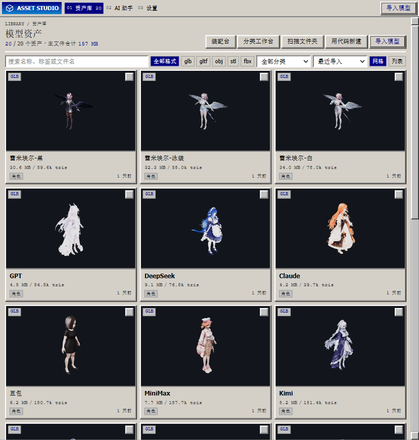

# ASSET STUDIO 0.1.0

首个可安装的 Windows 桌面版。



## 这个版本有什么

- **资产库**：GLB / GLTF / OBJ / STL / FBX 导入，PMX / `.blend` 交给本机 Blender 转换；网格 / 列表视图、搜索、格式与分类筛选、真实缩略图、批量删除。
- **检视台**：模型 / 实景 / 代码三模式，几何统计、包围盒、版本记录、PNG 导出。
- **代码建模**：用 sand3d 在本机 bpy 真跑，支持源码 / 由模型反推、就地更新与回滚。
- **装配台**：多零件摆位、父子层级、数值变换、三轴手柄、拖拽吸附、撤销 / 重做，导出为一个新 GLB。
- **AI 助手**：读取当前资产库上下文；Ollama 本机直连，另支持 OpenAI / DeepSeek / Kimi / 智谱 / 百炼 / SiliconFlow / Groq / LM Studio / 自定义端点，共 10 类 provider。
- **分类工作台**：批量分析、逐条采纳；AI 只给建议，采纳后才改正式分类。
- **首次引导**：欢迎 → 模型 → 完成；可以先跳过，之后在设置里补。
- **桌面套壳**：Electron + 同一份 Go 服务 + 同一份前端；启动自动拉起服务，关窗一并结束。

## 安装

1. 下载 `ASSET-STUDIO-0.1.0-Setup.exe`。
2. 双击运行，按 NSIS 向导完成安装。
3. 从开始菜单或桌面快捷方式启动 `ASSET STUDIO`。

安装包是 Windows x64、未做代码签名，SmartScreen 可能提示「未知发布者」；当前使用 Electron 默认图标。

## 数据位置

- 桌面版数据目录：`%APPDATA%\asset-studio\data`
- 日志：`%APPDATA%\asset-studio\server.log`
- 端口优先 `17890`，被占用时自动换一个空闲端口。

安装版首次启动是空库，不会自动带上开发目录里的资产。要复用现有资产库，把 `server\data` 整个拷到 `%APPDATA%\asset-studio\data`，或设置 `ASSET_STUDIO_DATA` 指向已有目录。

## 校验

```text
SHA256  2E7FBFFE4BC81CC2AA000B4387DEA2371E6F132A10E9ACBEF7CDD4F1B04C6DA8
文件    ASSET-STUDIO-0.1.0-Setup.exe
大小    130,799,007 bytes (124.74 MB)
```

## 已知限制

- 安装包未签名，使用 Electron 默认图标。
- 云端 provider 目前只有协议 / 表单 / 单元测试覆盖；本机 Ollama 是已跑通真实对话的 provider。
- 安装版与开发版数据默认分开；不会自动迁移。
- 装配台是摆位与组合工具，不是完整装配建模；没有自由平面 / 面吸附与约束。
- AI 分类只是建议，复杂模型仍可能判错；涉及删除、替换、运行仍需人工确认。

## 从源码运行

```powershell
git clone https://github.com/highho/ASSET-STUDIO.git
cd ASSET-STUDIO
npm install
.\server\start-server.bat
```

然后打开 `http://localhost:8080`。

更多说明见 [README](https://github.com/highho/ASSET-STUDIO/blob/main/README.md)。
